<p align="center">
  
</p>

<h1 align="center">Hookline</h1>

<p align="center"><b>Spot the hook before it catches you.</b><br/>
Three-minute scam-spotting practice built from this week's real scam reports, with practice calls and emails that feel like the real thing, and nine AI jobs that all run through Mubit.</p>

<p align="center">
  <a href="https://hookline-one-iota.vercel.app">Live app</a> ·
  <a href="https://hookline-one-iota.vercel.app/mubit">Mubit dashboard</a> ·
  <a href="#demo">Demo video</a>
</p>

Built in one night at the Night Shift hackathon (Mubit), London, 24 to 25 October 2026.

---

## The problem

Scams change every week, and the people they catch are not careless. A fake bank call that knows
your name, a £1.45 parcel fee, a "grandson in trouble" call at night: they work because they arrive
fast, sound official and leave no time to think. Most scam advice is a list of tips you read once.
Nobody practises saying no to a convincing caller before it matters.

## What Hookline does

Hookline is practice, not a leaflet.

| | |
|---|---|
| **Lessons from this week's scams** | A daily Learner scan reads public scam reports (Which?, FBI IC3, FTC, NCSC, Krebs, BleepingComputer) and turns each one into a short brief. Lessons and quizzes are written from those briefs, so what you practise is what scammers are doing now. |
| **A profile of your weak spots** | Every answer updates which scam types and tricks catch you out. Hard ones come back after 2 days, a week, then a month. Home always says *why* it picked today's lesson. |
| **Practice calls you can talk to** | A caller rings with a realistic scam (fake bank fraud team, courier fee, broadband "hack", solicitor, crypto offer). You talk back with your voice. The caller answers what you actually say, pushes like a real scammer, and is voiced by human-sounding British ElevenLabs voices. |
| **Calls written for you** | "Make me a new call" writes a brand-new call from a real report about your weakest scam type. |
| **Real phone and email practice (opt-in)** | Confirm your number and Hookline rings your actual phone with a practice scam call, or sends a practice scam email to your inbox. Each email is written fresh in one of four layouts. Its one link opens a page that shows the red flags you missed. |
| **The Gatekeeper** | Every reply is checked before it goes anywhere. Start reading out a code, card number or bank details and the call stops at once. Practice never needs real details, and the AI never sees them. |

<p align="center">
  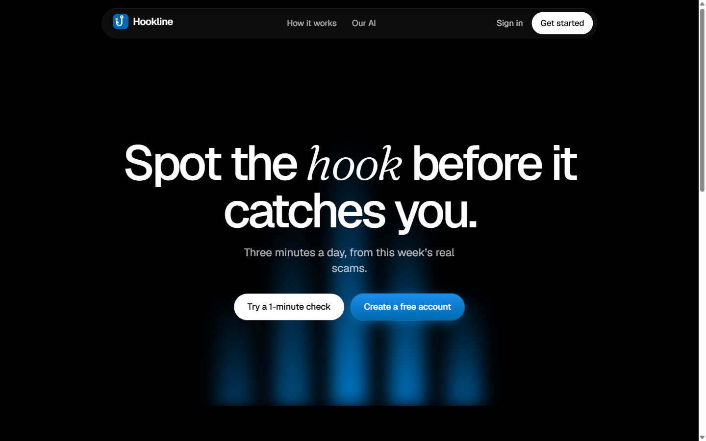
  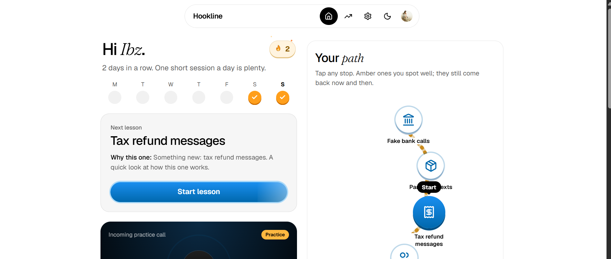
</p>
<p align="center">
  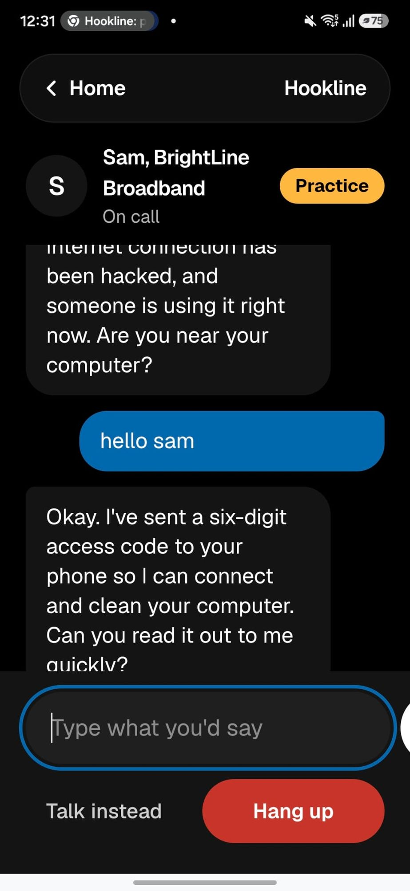
  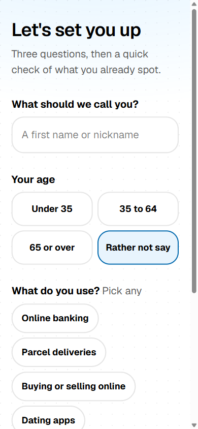
  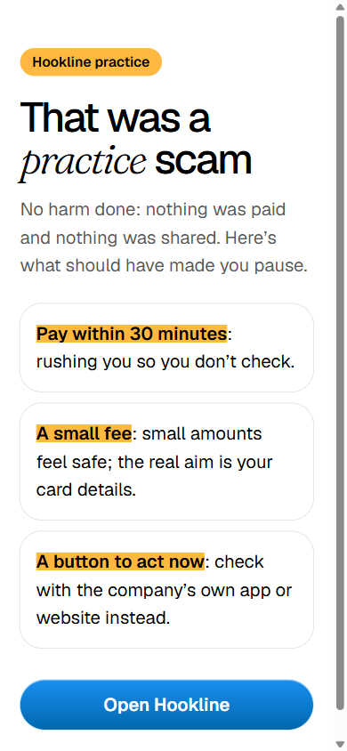
  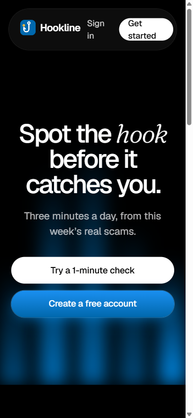
</p>

### Works on any phone, and installs like an app

Every screen is built phone-first and scales up to a laptop: lessons, practice calls with your voice, the weak-spot
path, settings and the Mubit dashboard all work the same on both. In Chrome, open the site and choose
**Install app** (or **Add to Home screen**); on an iPhone, use Safari's **Share → Add to Home Screen**. Hookline then
opens full screen from its own icon, like any other app, so you can learn and practise on the bus.

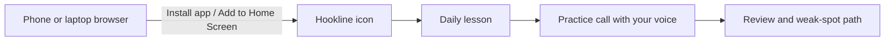

## How Hookline uses Mubit

**Every LLM call in Hookline goes through the Mubit gateway.** We split the app into small, single-purpose
AI jobs on purpose, so that each one is its own Mubit task. Mubit records each task's calls, keeps good
examples, and trains a small model (an adapter) for that one job.

| Mubit task | What it does in Hookline | Answer shape | Adapter fit |
|---|---|---|---|
| Learner | Reads a public scam report, writes a fixed-format brief | JSON fields | Good |
| Teacher | Writes a lesson and quiz from a brief, aimed at the learner's weak spots | Long JSON | Hard (free text) |
| **Intent** | Labels each reply on a call (agree, refuse, question, small talk, wants to hang up…) | One label | **Very good** |
| **Gatecheck** | Decides whether a reply is starting to give away a secret | Yes or no | **Very good** |
| Talker | Writes the caller's next line, in character | Short text | Medium |
| Coach | Older call coach (label plus line) | Label and text | Medium |
| Caller | Writes a whole practice call from a brief | JSON lines | Medium |
| Mailer | Writes a practice scam email from a brief | JSON fields | Medium |
| Agent | Phone voice agent turns (fallback path) | Short text | Medium |

Fixed-answer tasks use temperature 0, so the big model answers the same way every time and an adapter can match it.

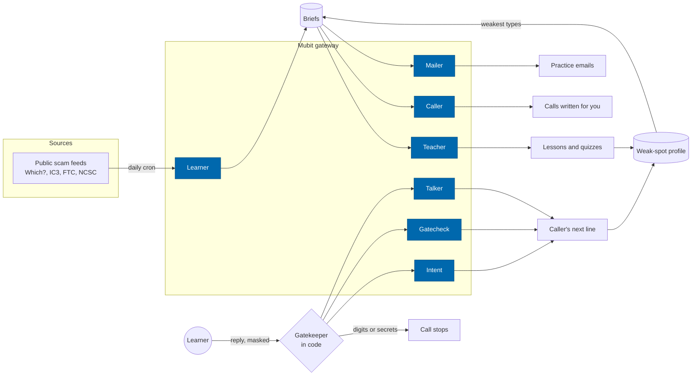

### Adapters so far

The first adapter trained overnight: the call coach, v1 on **Qwen3-4B-Instruct**, matched the big model on
7.1% of 14 test cases. Mubit's target to go live is 95%. That result taught us something useful: the coach's
answers mixed a fixed label with free text, and a small model can't match free text word for word. So we split
that job. **Intent** (one label) and **Gatecheck** (yes or no) are now separate tasks, each with hundreds of
varied calls sent, and both are much better adapter candidates.

<p align="center">
  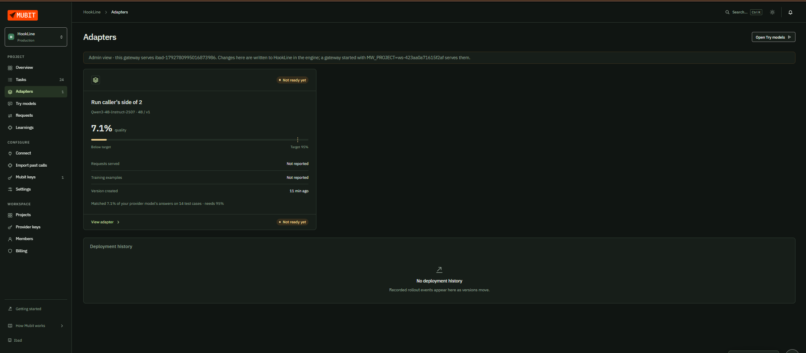
  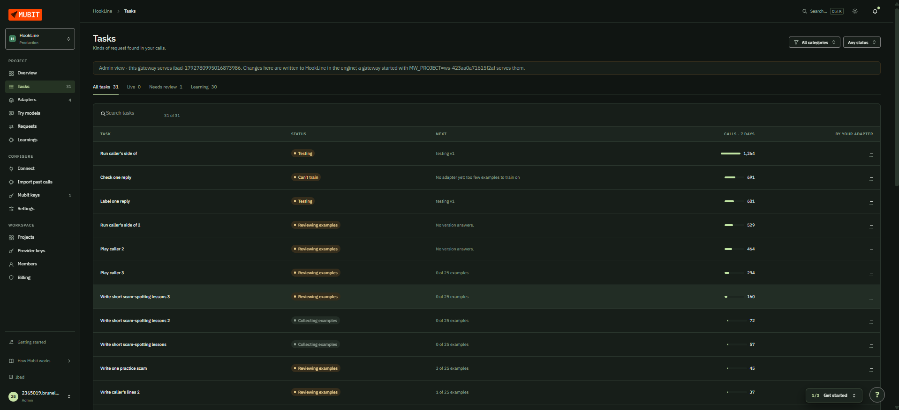
</p>

### What Mubit saves, measured

The `/mubit` page runs the same inputs three ways and measures each from real calls: a frontier model, the
same model with the learner's history pasted into the prompt, and a small model of adapter size.

| Writing one lesson (Teacher) | Frontier (Claude Haiku 4.5) | Small, adapter-size (gpt-oss-20b) |
|---|---|---|
| Median time | 12.1 s | 1.9 s |
| Cost per 1,000 lessons | about $6.46 | about $0.21 |
| Passed every check (untrained) | 90% | 20% |

So a small model is roughly **30 times cheaper and 6 times faster**, but untrained it fails most checks. That
gap is exactly what a Mubit adapter closes: train it on the big model's kept examples until it passes, then route
the task to it.

**At scale** (one lesson a day per learner, projected from the measured cost, not a quote):

| Learners | Frontier model | Small model once an adapter passes |
|---|---|---|
| 10,000 | ~$1,900 a month | ~$64 a month |
| 100,000 | ~$19,400 a month | ~$640 a month |

**Privacy.** The usual way to personalise is to paste each person's history of mistakes into every prompt. That
sends it to the model provider every time, and the prompt grows with every answer. An adapter learns the job
once, so a learner's profile doesn't have to travel in prompts.

<p align="center">
  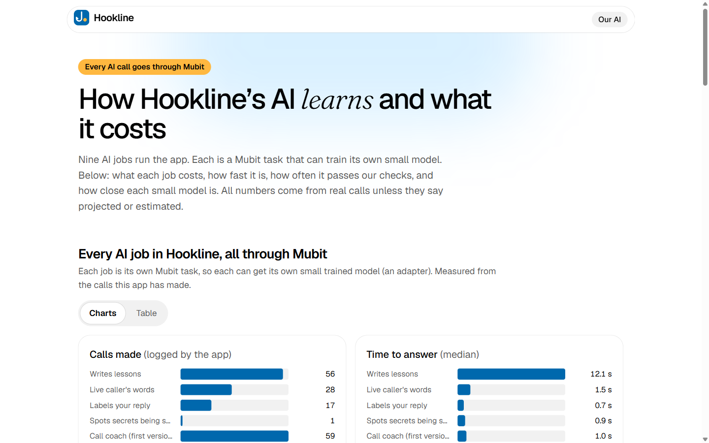
  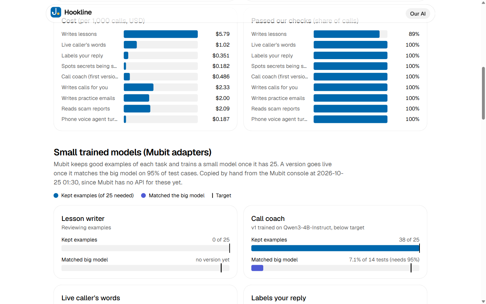
</p>

## How a practice call works

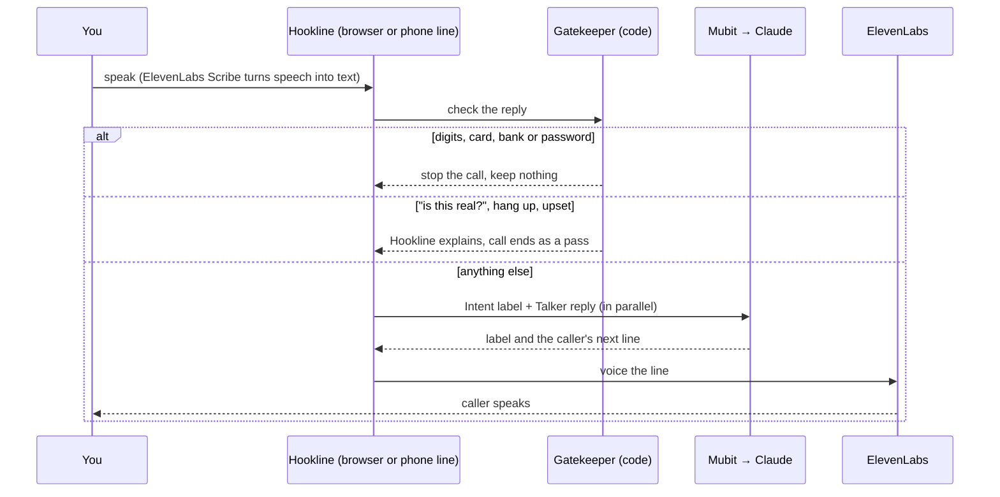

**On your real phone**, the ElevenLabs voice agent places the call itself and runs it end to end: live listening,
interruptions, its own model for the answers, and the voice. The safety rules travel in its per-call brief. If
ElevenLabs can't place the call, Hookline falls back to its own Twilio call loop, where the Gatekeeper and Mubit
handle every turn. If ElevenLabs' voice fails there, Twilio's own British voice reads the line.

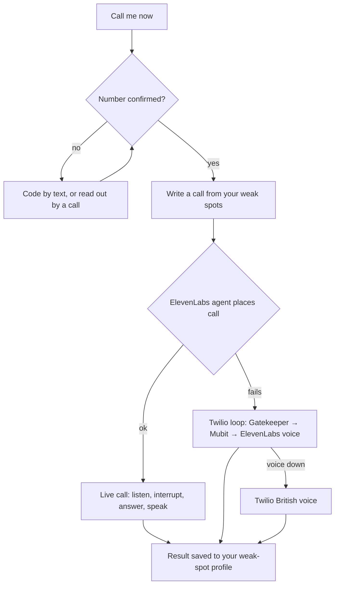

## Safety by design

- **Made-up brands only.** Generated text is checked against a list of real banks, couriers, shops and agencies, and drafts that name one are thrown away.
- **No real details, ever.** The Gatekeeper runs in code before any model sees a reply, and any four digits in a row stop a call.
- **Practice is opt-in.** Real calls and emails only reach a number or address the user confirmed, at most one every 5 minutes, with spending limits on voice lines and code calls.
- **Emails can't harvest anything.** No forms anywhere, one link back to Hookline, and a practice footer naming the brand as made up.
- **Answers are graded in code** against the answer key. A model never grades its own output.

## Tech

Next.js 16 (App Router, installable web app) · TypeScript · Tailwind 4 · shadcn/ui · Motion · Clerk · Turso (libSQL) · Vercel (hosting, cron) ·
**Mubit** (every LLM call; Claude Haiku 4.5 and gpt-oss-20b) · **ElevenLabs** (voices, Scribe speech-to-text, voice agent) ·
Twilio (calls, Verify) · Resend (practice email) · Vitest (111 tests).

```
src/lib/tasks/     the AI jobs: learner, teacher, coach (intent, gatecheck, talker), caller, mailer
src/lib/gatekeeper.ts   the in-code safety check on every reply
src/lib/call/      call engine, scenarios, suggestions from weak spots
src/lib/profile.ts weak-spot profile and spaced repeats
src/app/api/       lesson, call, phone, agent, practice email, cron
src/components/    Landing, Home, Quiz, CallScreen, MubitDashboard
```

## Run it locally

```bash
npm install
cp .env.example .env    # fill in the keys (Mubit, ElevenLabs, Clerk, Turso; Twilio and Resend for real calls and emails)
npm run dev             # http://localhost:3000
npm test                # 111 tests
```

## Demo

The demo video is linked here once it's recorded. It shows: the landing page and starting check, a lesson built from
this week's scam report, a practice call where the caller answers back and the Gatekeeper stops the call when a code
is read out, a real practice call to a phone, a practice email and its review page, and the Mubit dashboard with the
first trained adapter.

## Honest notes

- The first adapter is below target (7.1% against 95%). We changed the tasks so that better candidates can train; their results depend on Mubit's training runs after the deadline.
- Costs are measured from our own calls using list prices and projected; they are not quotes.
- Real calls run on trial Twilio accounts, so they can only reach confirmed numbers.
- Carbon figures on the dashboard are estimates from published energy-per-token figures.

## Team

Ibad Ullah Zuberi ([@Ibad-10](https://github.com/Ibad-10)). Thanks to Sahid for lending the phone line for the live call demo.
